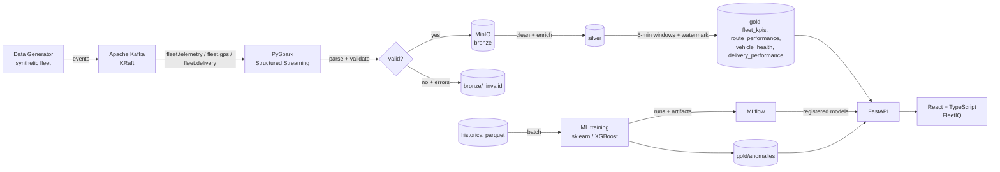

# FleetIQ — Real-Time Supply Chain Intelligence Platform

A portfolio-grade, end-to-end **simulated real-time logistics intelligence
platform**: synthetic fleet telemetry is streamed through Apache Kafka into
PySpark Structured Streaming, validated and stored in a MinIO medallion
data lake, mined by ML models tracked in MLflow, and exposed through a
FastAPI + React application.

> **⚠️ All data in this project is synthetic.** It is generated locally by
> `data_generator/` and does not correspond to any real fleet, company or
> person. Nothing here should be used to make real-world operational
> decisions.

---

## Overview

FleetIQ demonstrates the full data/AI stack in one locally runnable system:

* **Data Engineering**: Kafka topics, Spark Structured Streaming with
  event-time windows and watermarking, Parquet data lake.
* **Data Quality**: declarative validation rules (Pandera for batch +
  equivalent rules in Spark), invalid records routed to a quarantine area
  and reported.
* **Machine Learning**: ETA regression (baseline → Random Forest →
  XGBoost) with leakage-safe temporal splits, and unsupervised anomaly
  detection (Isolation Forest).
* **MLOps**: MLflow experiment tracking, model registry, offline drift
  monitoring (Evidently), Airflow batch DAG.
* **Full-Stack**: FastAPI (OpenAPI documented) + React/TypeScript/Vite/
  Tailwind/Recharts/TanStack Query dashboard.

## Business Problem

A fleet of ~500 delivery vehicles emits GPS + telemetry + delivery events.
The platform must answer, from a live stream:

1. Where are the vehicles?
2. Which deliveries are delayed?
3. Which vehicles show abnormal behaviour?
4. Which routes perform poorly?
5. What is the predicted ETA?
6. Which vehicles need attention?
7. How does fleet performance evolve over time?

## Architecture



### Data flow in detail

1. `data_generator` produces correlated synthetic events (traffic → speed,
   idle → fuel, vehicle age → anomalies, weather → ETA variation).
2. Producers push JSON events to `fleet.telemetry`, `fleet.gps`,
   `fleet.delivery`.
3. The Spark job reads Kafka, parses, validates (invalid rows go to
   `bronze/_invalid` with rule names), dedupes, enriches (fuel/100km) and
   computes 5-minute event-time aggregations into `gold/`.
4. Batch scripts train the ETA + anomaly models, tracked/registered in
   MLflow.
5. FastAPI serves gold tables + predictions; the React app renders the
   FleetIQ dashboard.

## Data Generation

`python -m data_generator` — fully local, reproducible, documented in
`data_generator/simulation.py`. Flags:

```
--vehicles N       number of vehicles (default 500)
--events N         historical cap on telemetry+GPS events (0 = unlimited)
--speed N          streaming mode: events per second
--seed N           reproducibility (default 42)
--days N           simulated days
--stream           stream to Kafka instead of writing files
```

Assumptions and correlations are documented in the module docstrings and in
`docs/features.md` (traffic hour profiles, rush hours, fuel curve, age →
anomaly risk, weather effects).

## Kafka Streaming

Topics (JSON, one schema per topic — see `streaming/kafka/schemas.py`):

| Topic | Event |
| --- | --- |
| `fleet.telemetry` | speed, fuel, engine load, temperature, idle, dt |
| `fleet.gps` | lat/lon/accuracy |
| `fleet.delivery` | status, planned arrival, parcels |

Events are validated with Pydantic **before** they reach the broker and are
keyed by vehicle/delivery id for per-entity ordering. JSON was chosen over
Avro/Schema Registry deliberately — see the module docstring.

## Spark Processing

`streaming/spark/streaming_job.py` (Kafka mode is the production path;
`--mode file` exists for tests/demos):

Kafka → parse schema → validate (rule array) → split valid/invalid →
watermark + dedupe → bronze → enrich → silver → 5-min windowed aggregates
→ gold. Watermark 10 min, 5-min tumbling windows, event-time processing,
checkpoints in MinIO. Gold tables: `fleet_kpis`, `route_performance`,
`vehicle_health`, `delivery_performance` (schemas in docs/data-lake.md).

## Data Lake

MinIO buckets: `bronze`, `silver`, `gold`, `checkpoints`, `raw`, `mlflow`.
Everything is Parquet. Schemas are documented in `docs/data-lake.md`.
A batch builder (`ml/gold.py`) produces the same gold schemas for local
development, CI and the Airflow DAG.

## Machine Learning

### ETA Prediction (`ml/train_eta.py`)

Target `delivery_duration_minutes`; features documented in
`docs/features.md` (leakage table included). Time-ordered 70/15/15 split —
**the test set is the future**. Baseline (median) → Random Forest →
XGBoost; evaluated with MAE/RMSE/R²; selection methodology in
`docs/ml-methodology.md`.

### Anomaly Detection (`ml/train_anomaly.py`)

Unsupervised Isolation Forest on standardized telemetry features.
Outputs: `anomaly_score`, `anomaly_flag`, `anomaly_type` (pattern
description, NOT a root cause). Limitations stated in the code, the API
responses and the Models page.

## MLflow

Experiment `supply-chain-intelligence`; models registered as
`eta_prediction` and `anomaly_detection`. Tracking server in Docker; local
development uses a file store (`./mlruns`).

## API

FastAPI + Pydantic, OpenAPI at `/docs`:

| Endpoint | Description |
| --- | --- |
| `GET /health` | service + data + model availability |
| `GET /api/kpis` | latest operational KPIs |
| `GET /api/kpis/series` | KPI time series (5-min windows) |
| `GET /api/fleet/summary` | fleet counts + status |
| `GET /api/fleet/vehicles` | vehicle list (search/filter/sort/page) |
| `GET /api/fleet/vehicles/{id}` | detail + history series |
| `GET /api/routes` | route performance |
| `GET /api/deliveries` | deliveries + filters |
| `GET /api/anomalies` | anomaly center |
| `GET /api/model/info` | model metadata + real metrics |
| `POST /api/predict/eta` | ETA prediction + interval |
| `POST /api/predict/anomaly` | anomaly scoring |

## Monitoring

**Offline / Simulated Monitoring** — `ml/drift.py` produces Evidently
reports (data + feature drift) comparing reference vs. current windows,
plus Pandera quality reports (`data_quality/`). These are on-demand
reports, NOT a live production monitor; there is no real production stream
here. The Airflow DAG runs them daily in batch mode.

## Docker

```bash
cp .env.example .env          # adjust secrets
docker compose up --build     # full stack
```

Services: `kafka` (KRaft), `kafka-init`, `minio` + `minio-init`, `mlflow`,
`data-init` (one-shot: generate → train → upload gold), `generator`
(continuous synthetic stream), `spark` (structured streaming), `backend`
(FastAPI), `frontend` (nginx + React). Airflow is an optional profile:
`docker compose --profile airflow up -d airflow`. All services have health
checks; secrets come from `.env` (never committed).

| Service | URL |
| --- | --- |
| FleetIQ UI | http://localhost:8081 |
| API docs (OpenAPI) | http://localhost:8000/docs |
| MinIO console | http://localhost:9001 |
| MLflow UI | http://localhost:5000 |
| Spark UI | http://localhost:4040 |
| Kafka | localhost:9092 |
| Airflow (profile) | http://localhost:8080 |

## Testing

```bash
pytest                      # all tests (spark tests need local winutils)
pytest --cov                # with coverage
ruff check                  # lint
cd frontend && npm run lint && npm test && npm run build
docker compose config       # validate compose
```

Test areas: generator (determinism, correlations, CLI), Kafka schemas,
Pandera data quality, Spark validation/aggregation logic, feature
engineering (leakage!), ML training (real metrics), FastAPI endpoints
(full stack via TestClient), frontend components, config edge cases.

## Project Structure

```
data_generator/     synthetic fleet simulator + CLI
streaming/kafka/    schemas, config, producer, consumer
streaming/spark/    structured streaming job + rules + aggregates
data_quality/       Pandera schemas + reports
ml/                 features, gold builder, train_eta, train_anomaly,
                    predict, drift
api/                FastAPI app, routers, services, schemas
frontend/           React + TypeScript app
airflow/dags/       daily batch DAG
docker/             Dockerfiles per service
scripts/            prepare_stream_input.py
tests/              pytest suites
docs/               features, data-lake, ml-methodology, monitoring
```

## Limitations

* **Synthetic data**: everything is simulated locally; no real fleet data.
* **Simulated streaming**: the stream runs locally (Docker or file mode).
* **Monitoring is offline**: reports are generated on demand, not live.
* **Unsupervised anomalies**: "unusual" ≠ "faulty"; anomaly_type describes
  measurement patterns, not causes.
* **ETA predictions are experimental** and trained on synthetic data.
* No real-world operational decisions should rely on this data.
* Streaming enrichment omits stateful lag-based features (documented in
  docs/data-lake.md) because Spark Structured Streaming rejects
  non-time-windowed LAG; those are computed in the batch pipeline.

## Future Improvements

* Avro + Schema Registry when multiple producer teams exist.
* Streaming model inference (`applyInPandas`) with periodic model refresh.
* Conformal prediction intervals; real-time Evidently monitoring.
* Multi-broker Kafka, Spark cluster mode, autoscaling.
* CI integration tests with a lightweight broker (e.g., Testcontainers).

